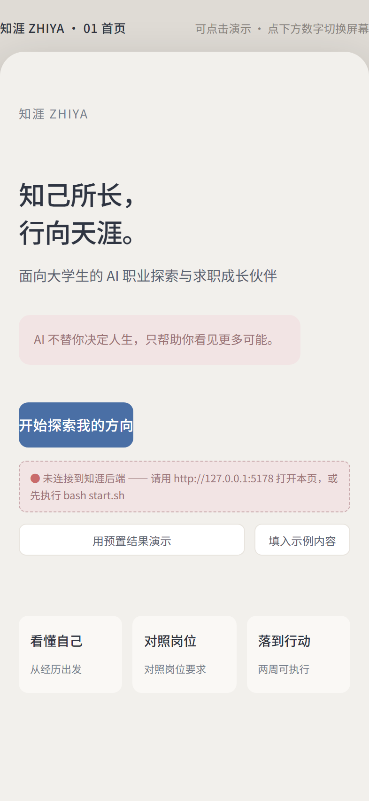
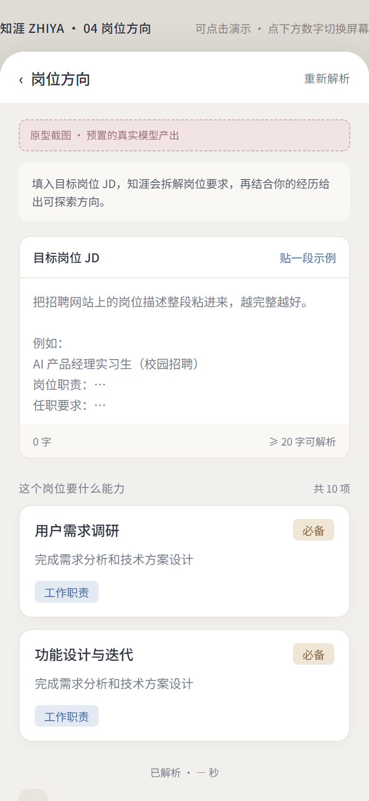
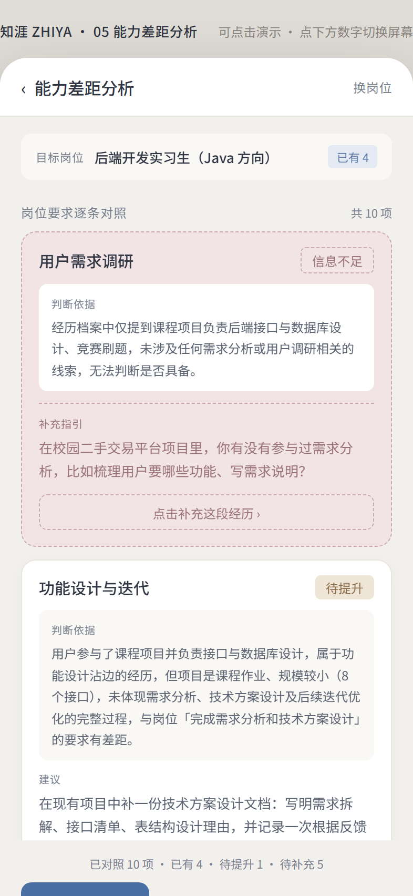
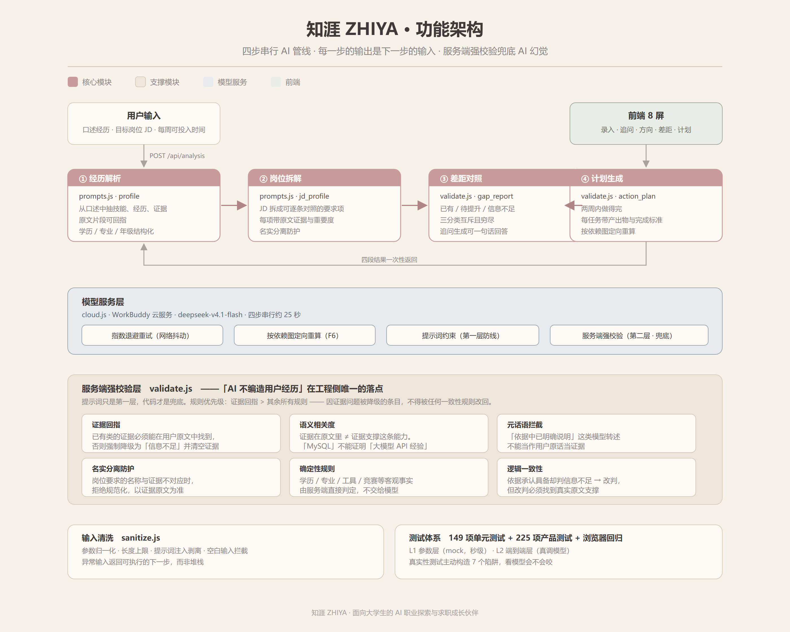
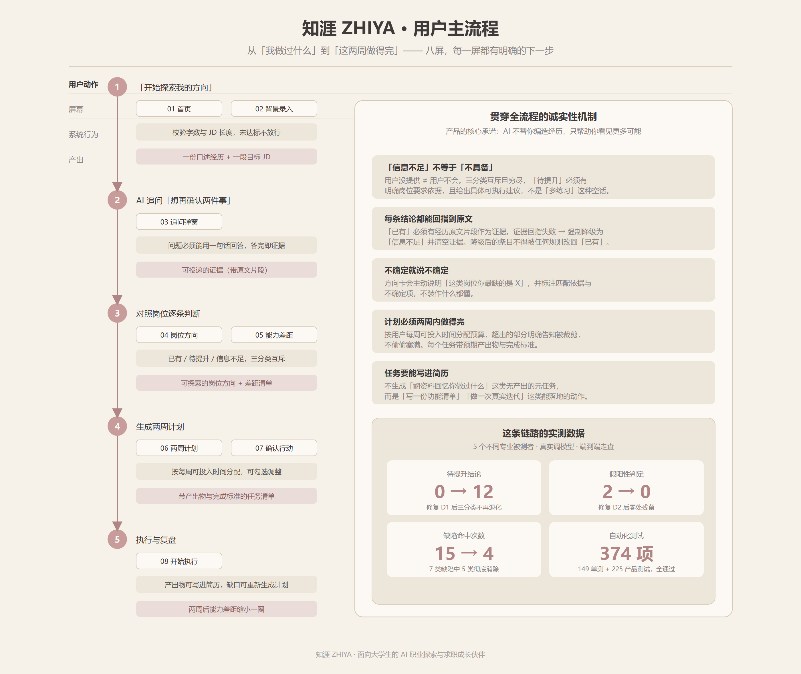
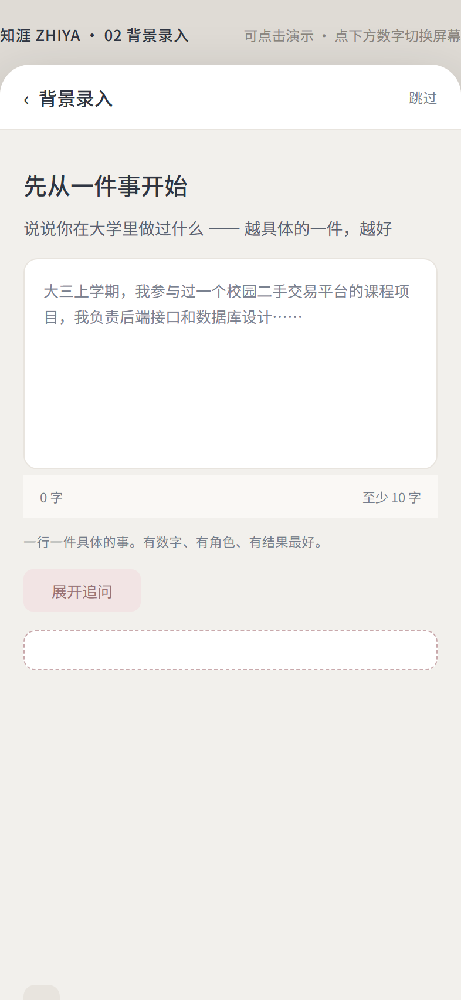

# 知涯 ZHIYA

**面向大学生的 AI 职业探索与求职成长伙伴**　·　知己所长，行向天涯

> AI 不替你决定人生，只帮助你看见更多可能。

知涯把大学生「我是谁、我能做什么、接下来做什么」这个问题拆成一条可验证的链路：
用户口述一段经历 → AI 追问出可投递的证据 → 对照目标岗位逐条判断差距 → 生成两周内做得完的行动计划。

本仓库是知涯的 **MVP 实现**：一个能真跑大模型、能在浏览器里完整操作、并且**用服务端代码兜住 AI 幻觉**的产品。

<p align="center">
  
</p>

<p align="center">
  <a href="https://zhiya-career.app.workbuddy.host/?sharecode=WVJRC4JK5Y">在线作品集主页 →</a>
　·　<a href="docs/Usability-Test-Report-V2.0.docx">下载可用性测试报告（缺陷定位与修复前后对比）→</a>
</p>

---

## 这个项目在证明什么

| 维度 | 事实 |
| --- | --- |
| **产品定义** | 从 4 人深访 → 5 条洞察 → 5 款竞品矩阵 → 决策收敛 → PRD（50 条验收标准）→ 可运行实现 |
| **工程实现** | Express + 四步串行 LLM 管线，约 1.1 万行；149 项单元测试 + 225 项产品测试全通过 |
| **质量验证** | 5 个专业背景被测者端到端走查（真实调模型），定位 7 类可复现缺陷并全部定位到代码行 |
| **迭代闭环** | 修复两个 P0 缺陷后复测：待提升结论 0 → 12 条，假阳性 2 → 0 处，缺陷命中 15 → 4 次 |

### 最值得看的一段：AI 如何被约束

绝大多数「AI 产品」只是把用户输入丢给模型、把模型输出直接显示。这个项目认为**那样不可信**，
所以把产品纪律写进了服务端代码 —— 提示词只是第一层，代码才是兜底：

```
模型输出 ──► 服务端强校验 ──► 不可信的结论被降级为「信息不足」
              │
              ├─ 证据回指：have 类的证据必须能在用户原文中找到，否则强制降级
              ├─ 语义相关度：证据在原文里 ≠ 证据支撑这条能力（MySQL 不是大模型 API 经验）
              ├─ 元话语拦截：「依据中已明确说明」这类模型转述不能当证据
              ├─ 名实分离防护：岗位要求的名称与证据不对应时，拒绝规范化
              └─ 确定性规则：学历 / 专业 / 工具 / 竞赛等客观事实由服务端直接判定
```

**规则优先级：证据回指 > 其余所有规则。** 因证据问题被降级的条目，
不会被后续任何一致性规则改回 have —— 否则「不编造」的底线会被击穿。

这套约束直接对应产品的核心承诺：**AI 不替你编造经历，只帮助你看见更多可能。**

---

## 三分钟看到产品

<div align="center">
  
  
  
</div>

<p align="center">
  <em>左：AI 给出的岗位方向与匹配依据　中：能力差距三分类　右：两周行动计划</em>
</p>

截图取自 **2026-11-09 修复后的真实模型产出**（5 个不同专业被测者之一），
不是设计稿。中屏的「功能设计与迭代」被判为**待提升**——
用户参与过课程项目的接口与数据库设计，但项目规模小、未体现需求分析与迭代优化的完整流程，
所以判「沾边但不够」而非「已有」或「信息不足」。

### 方式一：在线直连（推荐，无需安装任何东西）

**https://zhiya-career-41390.app.workbuddy.host/?sharecode=ZIDF2K3Q6W**

云端部署版本，前后端常驻，真实模型链路完整可用（单次分析约 20 秒）。
打开链接即可体验完整 8 屏流程 —— 这是投递简历时最该发给面试官的入口。

> 首次访问需在浏览器打开上面**完整链接**（含 `sharecode` 参数）。
> 直接访问裸域名会返回「链接不完整」，这是分享链接的访问保护，不是服务故障。

### 方式二：离线单文件版（不需要服务器、不需要网络）

下载仓库后双击 `demo-offline.html`（已随仓库提供，快照已内联），
或自行构建：

```bash
npm install && npm run build
```

演示快照已内联，**完全断网也能走完 8 屏完整流程**。

### 方式三：本地跑真实模型

```bash
cp .env.example .env.local    # 填入 WB_CLOUD_PUBLISHABLE_KEY
bash start.sh                 # Windows Git Bash / macOS / Linux
```

打开 **http://127.0.0.1:5178**。完整链路约 25 秒（云服务四步串行）。

> 页面也可从静态预览端口或 `file://` 打开 —— 前端内置地址探测，会自动找到后端并在首页显示连接状态。

---

## 完整文档与图示（全部可下载）

### 产品定义 —— 从洞察到 PRD 的完整链路

| 文档 | 内容 | 规模 |
| --- | --- | --- |
| [《知涯 · 用户调研报告》](docs/product-docs/01-User-Research-Report.docx) | 4 名在校生深度访谈，5 条核心洞察，12 项痛点编码 | 6800 字 · 4 表 |
| [《知涯 · 竞品分析报告》](docs/product-docs/04-Competitive-Analysis.docx) | 5 款代表性竞品，16 维功能矩阵，「广度 × 深度」战略象限定位 | 12000 字 · 16 表 |
| [《知涯 · 产品决策书》](docs/product-docs/02-Product-Decision-Book.docx) | 三个核心问题的收敛答案，每条决策可回溯到具体访谈证据 | 11500 字 · 25 表 |
| [《知涯 · 产品定位文档》](docs/product-docs/03-Product-Positioning.docx) | 目标用户、核心场景、需求优先级、MVP 范围与验证指标 | 16180 字 · 38 表 |
| [《知涯 PRD V0.5》](docs/product-docs/05-PRD-V0.5.docx) | 10 章 + 50 条 Given-When-Then 验收标准 + 14 条业务规则 + 9 个埋点事件 | 22300 字 · 78 表 |

### 质量验证 —— 缺陷定位与修复闭环

| 文件 | 说明 |
| --- | --- |
| [可用性测试报告 V2.0（Word）](docs/Usability-Test-Report-V2.0.docx) | 正式版：封面 / 目录 / 页码齐全，含修复前后对比表 |
| [可用性测试报告 V2.0（Markdown）](docs/Usability-Test-Report-V2.0.md) | 同上纯文本版，便于检索与阅读 |
| [修复闭环说明](docs/fix-closure.md) | 一页版：根因、改法、验证数据 |
| [V1/V2 对比数据](docs/v1-v2-对比数据.json) | 修复前后原始指标，可自行复核 |
| [GitHub 作品集搭建指南](docs/GitHub作品集搭建指南.md) | 本次开源实践的方法论沉淀，含 6 个真实坑位与 17 项检查清单 |

### 图示 —— 全部为矢量重绘，无第三方水印

| 图 | 说明 |
| --- | --- |
| [功能架构图](docs/diagrams/architecture.png) | 四步串行管线 + 模型服务层 + 服务端强校验层 ｜ [SVG 源文件](docs/diagrams/architecture.svg) |
| [用户流程图](docs/diagrams/userflow.png) | 八屏主流程 + 贯穿全流程的诚实性机制 + 实测数据 ｜ [SVG 源文件](docs/diagrams/userflow.svg) |

<p align="center">
  
</p>

<p align="center">
  
</p>

### 原型界面（8 屏实机截图）

<p align="center">
  
  
  
  
</p>

<p align="center">
  
  
  
  
</p>

---

## 一分钟跑起来

**Windows（推荐）**：双击项目根目录的 `启动后端.bat`，或桌面上的「启动知涯后端」。
脚本会自动定位项目目录、探活检测、崩溃自动重启，并在就绪后自动打开浏览器。

```bash
# macOS / Linux / Git Bash
cd zhiya-mvp
bash start.sh
```

打开 **http://127.0.0.1:5178** 即可。前端页面在 `public/`，接口在 `server/`。

> ⚠️ **必须用 http://127.0.0.1:5178 打开**，不要用 WorkBuddy 的静态预览面板，也不要直接双击 html。
> 预览面板是静态服务器，没有 `/api/analysis` 路由，页面会提示「连接到了错误的服务器」。
> （新版前端已内置地址探测，从任何入口打开都会自动找到后端并在首页显示连接状态，
> 但推荐仍用上面的地址，功能最完整。）

**启动器命令**（`scripts/launch.mjs`）：

| 命令 | 作用 |
|---|---|
| `node scripts/launch.mjs` | 启动后端并自动打开浏览器（已在跑则直接复用） |
| `node scripts/launch.mjs --status` | 查看运行状态 |
| `node scripts/launch.mjs --stop` | 停止守护进程 |
| `node scripts/launch.mjs --no-open` | 启动但不打开浏览器 |

日志写入 `logs/server.log`。后端进程崩溃会自动退避重启（最多 10 次）。

**环境变量**（在 `.env.local` 里配置，该文件已被 `.gitignore` 排除，模板见 `.env.example`）：

| 变量 | 说明 |
|---|---|
| `WB_CLOUD_ENDPOINT` | 云服务地址 |
| `WB_CLOUD_PUBLISHABLE_KEY` | 云服务公钥（前端可持有，后端服务端亦可用） |
| `ZHIYA_MODEL` | 模型 id，默认 `deepseek-v4.1-flash` |
| `PORT` | 端口，默认 5178 |

## 架构

```
浏览器 (public/)
   │  POST /api/analysis
   ▼
Express (server/index.js)
   │
   ├─ pipeline.js ── 四步串行编排 + F6 依赖图重算 + 差异对比
   │      ├─ ① profile   经历解析
   │      ├─ ② jd_profile  JD 解析
   │      ├─ ③ gap_report 能力差距对照（只吃①②产物）
   │      └─ ④ action_plan 行动计划（只吃③产物）
   │
   ├─ prompts.js ── 四步系统提示词（产品纪律写在这里）
   ├─ validate.js ── 结构校验 + 证据回指硬校验（纪律的代码兜底）
   └─ cloud.js ──── 云服务 LLM 客户端（SSE 累积 / JSON 清洗 / 超时）
```

## 关键设计

### 1. 单接口，四步串行

`POST /api/analysis` 一次请求返回四段结果：

```json
{
  "profile": { "experiences": [...], "skills": [...], "missing_fields": [...] },
  "jd_profile": { "requirements": [{ "item", "category", "importance", "evidence" }] },
  "directions": [{ "role", "reason", "uncertainty", "matched_evidence" }],
  "gap_report": { "items": [{ "requirement", "status", "evidence", "basis", "advice", "prompt" }] },
  "action_plan": { "tasks": [{ "title", "priority", "expected_output", "completion_criteria", "basis" }] }
}
```

后三步的输入严格限定为前一步的产物——这是「AI 不编造用户经历」在工程侧唯一的落点，不能靠提示词自觉保证。

### 2. 三分类互斥

`status` 只允许 `have` / `improve` / `unknown`。

- 用户**完全没提**某项能力 → `unknown`（信息不足），**不是** `improve`
- `improve` 必须有具体可执行的 `advice`
- `unknown` 必须有具体的 `prompt`（一句话能答的问题）

### 3. 证据回指硬校验

`have` 类结论的 `evidence` 必须能在经历档案的原文片段中找到，否则服务端强制降级为 `unknown` 并清空伪造证据。违规记录在 `violations`。

同类地：任务四要素不全 → 丢弃；任务依据不在差距报告里 → 丢弃；总时长超预算 → 按 P0→P2 裁剪。

### 4. 可复现性（AC-50）

同一份输入必须给出同一份结论。模型对同一条要求的措辞每次都不同（「需求调研」/「AI 产品需求调研与功能设计」），因此：

- 能力项名称由**服务端查表**决定，不采信模型措辞
- 学历/专业背景由服务端依据原文直接判定，专业是否相关按大类匹配表判定
- 学历门槛统一归并为一项；并列式要求按固定顺序拆分

**五条服务端确定性规则**（模型的自由推理不能覆盖这些）：

| 规则 | 触发 | 处理 |
|---|---|---|
| 证据回指 | `have` 的证据无法在原文回指 | 降级 `unknown` + 清空证据 |
| 学历专业 | 原文写了「计算机专业大三」 | 直接判 `have`（客观事实） |
| 工具技能 | 原文提到 Canva / PS / Figma 等工具名 | 对应工具类能力项判 `have` |
| 逻辑冲突 | 依据说「明确列出 Canva」却判 `unknown` | 改判 `have` |
| JD 分类 | 模型把「专业背景」标成 `plus_skill` | 学历/专业类固定 `major_req` |
| 低质任务 | 任务是「写自查清单」这类元任务 | 丢弃（不产出可用的东西） |

**规则优先级**：证据回指 > 其余所有规则。因证据问题被降级的条目，
不会被后续任何规则改回 `have` —— 否则「不编造」的底线会被逻辑一致性规则击穿。

### 5. F6 依赖图重算（R-14）

`POST /api/analysis/regenerate` 按依赖图定向重跑，不做无谓的整链重刷：

| 变更字段 | 重跑步骤 |
|---|---|
| `raw_text` / `followups` | ①②③④ 全链 |
| `jd_text` / `target_role` | ②③④ |
| `weekly_hours` | ④ |

返回 `recomputed_scope`（实际重跑了什么）与 `diff`（逐条 before/after）。失败时保留旧结果并置 `fallback_available: true`。

## 面试演示

```bash
# 1. 启动后端
bash start.sh

# 2. 打开 http://127.0.0.1:5178
# 3. 首页点「用预置结果演示」→ 零延迟走完完整流程（85ms）
```

**离线单文件版**：仓库根目录 `demo-offline.html` —— 双击即开，不需要服务器，断网也能走完流程。

重新构建：`node build/single-file.js`

**演示素材与逐字稿**：[`demo/面试演示脚本.md`](demo/面试演示脚本.md)

三层方案：

| 方案 | 何时用 | 效果 |
|---|---|---|
| A 现场真跑 | 网络正常 | 最有说服力，30 秒生成 |
| B 预置结果 | 网络不稳 / 时间紧 | 首页一键切换，零延迟 |
| C 录屏兜底 | 现场翻车 | 保底 |

演示模式的预置结果 `demo/snapshot.json` 是**真实模型跑出来的快照**，不是手写假数据。
重新生成：`node demo/snapshot.js`

---

## 测试

### 产品测试（按七类验收）

```bash
node test/run-all.js          # ★ 七类完整测试，输出统一报告
node test/report.js            # 把结果转成 Markdown 报告
```

七类覆盖：输入 / AI 解析 / 差距分析 / 计划生成 / 真实性 / 异常 / 用户体验。
结果同时写入 `test-results/latest.json` 与 `test-results/测试报告.md`。

单类可单独跑：

```bash
node test/t01-input.js         # 输入测试
node test/t02-parse.js         # AI 解析测试
node test/t03-gap.js           # 差距分析测试
node test/t04-plan.js          # 计划生成测试
node test/t05-truth.js         # 真实性测试（7 个陷阱，专门钓编造）
node test/t06-error.js         # 异常测试
node test/t07-ux.mjs           # 用户体验测试（真实浏览器）
```

> 设计原则：**参数处理与模型行为分层测试**。前者用 mock 探测（秒级），
> 后者才调真实模型。全套约 5–8 分钟；早期版本把参数变体也走真模型，单类要 13 分钟。

### 单元测试（不调模型，秒级）

```bash
node test/validate.test.js          # 校验逻辑 + 确定性规则（38 项）
node test/sanitize.test.js          # 输入清洗与类型校验（41 项）
node test/plan-alloc.test.js        # 计划周分配/排序/低质任务过滤（24 项）
node test/retry.test.js             # 模型重试判定（26 项）
node test/framework.selfcheck.js    # 断言框架自检（23 项）
```

### 回归测试

```bash
node test/e2e.js                    # 端到端验收（45 项，调真实模型）
node test/frontend.test.js          # 前端渲染逻辑（29 项）
node test/frontend-robust.test.js   # 前端健壮性（18 项）
node test/stability.js              # 稳定性：同一输入连跑 N 次统计波动
node test/browser.test.mjs          # 真实浏览器：四种入口场景探测（4 项）
node test/browser-e2e.mjs           # 真实浏览器：完整链路（31 项）
node test/browser-demo.mjs          # 真实浏览器：演示模式（24 项）
node test/single-file.test.mjs      # 单文件版：file:// 双击打开（23 项）
node test/single-file-offline.test.mjs  # 单文件版：断网离线（14 项）
```

端到端测试逐条实测 MVP 的 7 条最终验收标准，以及 PRD 的 AC-27~AC-43。

## 桌面单文件版

`build/single-file.js` 把 index.html + style.css + app.js + demo/snapshot.json 合成一个自包含 HTML，
仓库内已提供构建产物 `demo-offline.html`（74KB，快照内联，断网可跑）。

特点：
- **双击即开**，不需要服务器
- **演示快照内联** → 完全断网也能走完整个流程（离线实测 233ms）
- **后端可达时自动用真实模型**，不通时自动降级并标注「离线模式」
- 带版本号与构建时间页脚

改前端后重新构建：`node build/single-file.js`

端到端测试逐条实测 MVP 的 7 条最终验收标准，以及 PRD 的 AC-27~AC-43。

浏览器测试需要 `npx playwright install chromium`（已装）。

## 输入校验与清洗（server/sanitize.js）

用户输入在**进模型之前**要过两道关：

**1. 类型校验** —— 非字符串直接拒绝，不能靠 `String()` 硬转。

```js
String({ a: 1 })  // "[object Object]"  长度 15 > 10，会绕过长度检查
```

所以 `{ a: 1 }` 会被当成"用户写了 15 个字"送去分析。现在返回 `raw_text_invalid_type`。

**2. 内容清洗** —— 剥离 HTML / JS 标记。

云服务有 WAF，含 `<script>` 的请求会被直接拦截，导致整次分析返回 500。
用户粘贴技术经历时完全可能带这类字符，所以在路由层和 pipeline 层各洗一次
（纵深防御）。清洗保留语义，只去结构：

| 输入 | 输出 |
|---|---|
| `<script>alert(1)</script>` | （空） |
| `` | （空） |
| `javascript:alert(1)` | `alert(1)` |
| `我是计算机专业大三学生` | 不变 |

**3. `weekly_hours` 归一化** —— 负数回退默认 10，而不是被钳到 2。

`Math.max(2, Math.min(60, Number(x) || 10))` 对 `-5` 会算出 `2`，
意思是"每周 2 小时" —— 一份用户根本完不成的计划。现在改为回退默认 10。

## 模型调用重试

云服务会出现瞬时网络失败（`Network error: fetch failed`）。
单次失败就让整次四步分析返回 500，用户体验极差。

现在 `callModelForJson` 内置**指数退避重试**（最多 2 次，800ms → 1600ms），
只对可重试的错误生效：

- **可重试**：网络错误、超时、5xx、429 限流、模型空输出、JSON 解析失败
- **不可重试**：参数错误、鉴权失败、模型不存在 —— 重试只是浪费时间

## 前端健壮性设计

页面可能从三种入口打开，接口地址必须自适应：

| 入口 | 问题 | 处理 |
|---|---|---|
| 后端同源 `127.0.0.1:5178` | 无 | 直接用（推荐） |
| 静态预览面板（其他端口） | 相对路径打到错误的服务器 → 404 `Not Found` | 探测后自动降级到 `5178`；后端已开 CORS |
| 双击 html（`file://`） | 相对路径完全不可用 | 同上，并提示正确地址 |

四条防线：

1. **地址探测**：`detectApiBase()` 依次试同源 → `127.0.0.1:5178` → `localhost:5178`，取第一个 `/api/health` 返回 `ok:true` 的。
   ⚠️ **同源可用时返回的是空字符串 `''`**，这是有效结果不是失败 —— 判断成败必须用 `=== null`，用 `!base` 会误判。
2. **探测超时**：每个候选 1.5s 超时。预览服务器对未知路径可能既不返回也不报错（直接挂起），没有超时探测会卡死。
3. **响应解析**：`parseResponse()` 先读 text 再判能否 `JSON.parse`。响应不是 JSON 时抛 `non_json_response`，不再把 `Unexpected token 'N'` 这类噪音甩给用户。
4. **错误分类**：`explainError()` 把异常翻译成「连接到了错误的服务器」「连不上知涯后端」等可执行提示，并给出启动命令或正确地址。

后端已加 CORS（回显任意 Origin + 预检 204），保证跨端口调用可行。

## 开发期缓存策略

静态资源一律 `Cache-Control: no-store`，且 `index.html` 引用带版本号（`app.js?v=20261031-2`）。
改前端后不必清缓存，浏览器必定拉新版。**改完前端记得同步更新版本号。**

## 模型选型

| 模型 | 用途 | 说明 |
|---|---|---|
| `deepseek-v4.1-flash` | 主力 | JSON 输出最干净，无 reasoning 污染 |
| `auto` | 备选 | 自动路由，但思考型模型会把 JSON 生成在 reasoning 阶段，需兜底 |
| `glm-4.7` | ❌ 不可用 | 目录里标记 enabled，实际调用报 `request_invalid_parameter` |

> `auto` 路由到思考模型时，JSON 会出现在 `reasoning_content` 而 `content` 为空。
> `cloud.js` 的 `callModelForJson` 已做兜底：从 reasoning 尾部提取 JSON。

## 已知限制

- 结果存储在内存（上限 200 条），进程重启即丢失。生产环境需接数据库。
- 前端未做登录，数据仅本人可见的前提依赖部署环境。
- 「岗位方向」目前基于用户粘贴的 JD 生成；岗位库（5 族 25–30 个岗位）尚未接入。
- 模型输出有随机性。同样的输入，任务标题的具体措辞可能不同（**结论一致**，措辞不保证一致）。
  这是生成式模型的固有特性，服务端已把「结论层」做成确定性的（能力项名称、状态判定、排序、时长裁剪），
  但「措辞层」无法也不应该强行固定。
- 单次完整分析耗时 30–60 秒（云服务四步串行 + 方向候选）。网络抖动时会自动重试，最坏约 3 倍耗时。

## 常用命令

```bash
npm start              # 启动后端（http://127.0.0.1:5178）
npm test               # 七类产品测试（225 项，约 4.5 分钟）
npm run test:unit      # 单元测试（129 项，秒级，不调模型）
npm run test:e2e       # 端到端验收（45 项）
npm run test:browser   # 真实浏览器测试（35 项）
npm run test:report    # 生成测试报告（md + html）
npm run build          # 生成桌面单文件版
```

